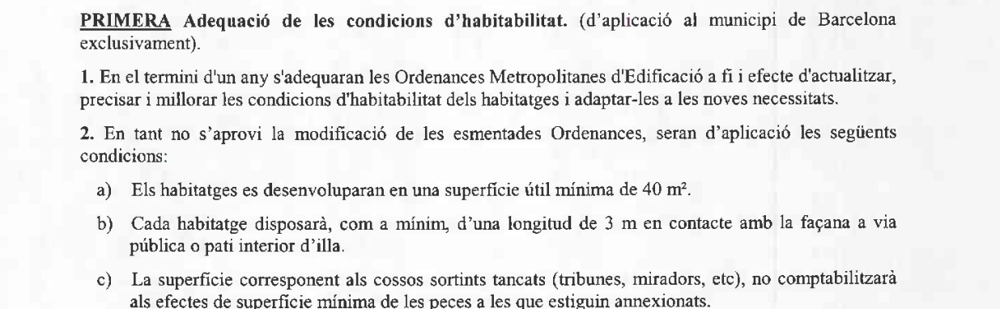
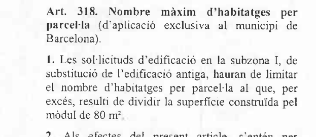
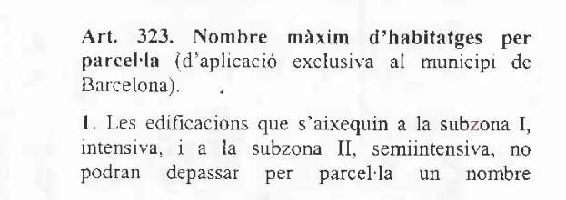
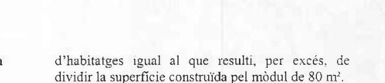

# Check the 4 scanned quotes by eye

The MPGM 2004 is a scan with no text layer, so these 4 quotes were read on the page images and typed by Claude (not OCR).
Please compare each quote with the crop above it, letter by letter (accents, apostrophes, `l·l`, numbers), then reply
"quotes OK" or list the differences.

Source: MPGM 2004, nombre màxim d'habitatges per parcel·la (Barcelona), RPUC expedient 215050, document 126035:
<https://planejamenturbanisme.territori.gencat.cat/RPUC-portal/rest/consulta/documents?documentId=126035&downloadType=1&idioma=ca>
(page numbers are the PDF's; the crops were made from the file `tools/get_rulebook.py` downloaded, at 170 dpi).

## 1. `BCN-MPGM2004-area-01` — Barcelona: minimum useful area of a dwelling, 40 m²

**Article:** Disposicions addicionals de la MPGM · Primera, 2 a) · **PDF page:** 19 · Look at line a).

**Our quote:**

> a) Els habitatges es desenvoluparan en una superfície útil mínima de 40 m².

- [ ] matches the scan

## 2. `BCN-MPGM2004-facade-01` — Barcelona: at least 3 m of façade per dwelling

**Article:** Disposicions addicionals de la MPGM · Primera, 2 b) · **PDF page:** 19 · Look at line b) (the same crop as above).

**Our quote:**

> b) Cada habitatge disposarà, com a mínim, d’una longitud de 3 m en contacte amb la façana a via pública o pati interior d’illa.

- [ ] matches the scan

## 3. `BCN-MPGM2004-density-12` — Zone 12: dwellings per plot = built area / 80 m², rounded up

**Article:** Art. 318.1 · **PDF page:** 21 · Look at paragraph 1 of art. 318.

**Our quote:**

> 1. Les sol·licituds d’edificació en la subzona I, de substitució de l’edificació antiga, hauran de limitar el nombre d’habitatges per parcel·la al que, per excés, resulti de dividir la superfície construïda pel mòdul de 80 m².

- [ ] matches the scan

## 4. `BCN-MPGM2004-density-13` — Zone 13: dwellings per plot = built area / 80 m², rounded up

**Article:** Art. 323.1 · **PDF page:** 21 · Paragraph 1 of art. 323 starts at the bottom of the left column (first crop) and ends at the top of the right column (second crop).

**Our quote:**

> 1. Les edificacions que s’aixequin a la subzona I, intensiva, i a la subzona II, semiintensiva, no podran depassar per parcel·la un nombre d’habitatges igual al que resulti, per excés, de dividir la superfície construïda pel mòdul de 80 m².

- [ ] matches the scan
